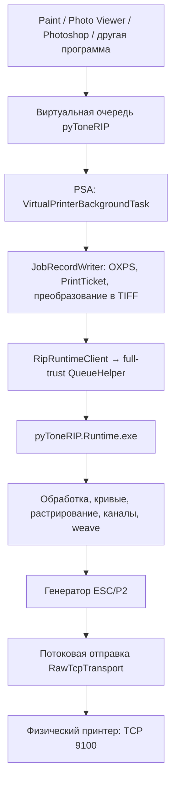
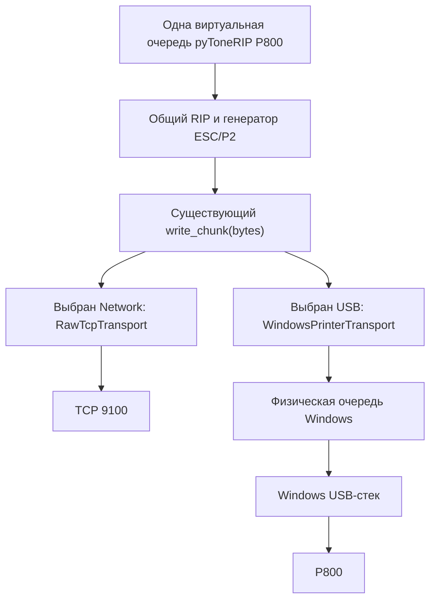

# Архитектура USB-печати в PyToneRIP

Дата анализа: 2026-10-12.

Статус: архитектурный анализ; USB-транспорт ещё не реализован. Ниже сохранён отчёт из обсуждения. В ходе анализа исходники не изменялись, компоненты не устанавливались, задания на печать не отправлялись.

**Одна виртуальная очередь pyToneRIP должна позволять выбрать TCP 9100 или USB.** Выбор подключения меняет только отправку готовых данных. Виртуальный принтер, настройки, кривые и генератор ESC/P2 остаются общими.

## A. Текущая архитектура проекта

**VERIFIED FROM REPOSITORY — подтверждено исходниками.**

Фактический путь задания:



Основные участки:

| Файл | Класс / метод | Назначение |
|---|---|---|
| `windows_psa/pyToneRIP/Services/VirtualPrinterManagementService.cs` | `InstallAsync` | Создаёт виртуальную очередь через `VirtualPrinterManager.InstallVirtualPrinterAsync`. |
| `windows_psa/pyToneRIP/Services/ModelPdcProvider.cs` | `LoadForQueueAsync` | Загружает PDC модели и локализованный PDR. |
| `windows_psa/pyToneRIP/Tasks/VirtualPrinterBackgroundTask.cs` | `OnDataAvailable` | Получает задание, запускает обработку, возвращает Windows результат. |
| `windows_psa/pyToneRIP/Services/JobRecordWriter.cs` | `CaptureAsync` | Сохраняет входные данные и PrintTicket, вызывает Windows XPS→TIFF. |
| `windows_psa/pyToneRIP/Services/CoreAppServiceClient.cs` | `ExecuteAsync` | В основном пакете непосредственно вызывает `RipRuntimeClient`; AppService используется другой веткой. |
| `windows_psa/pyToneRIP/Services/RipRuntimeClient.cs` | `ExecuteAsync` | Формирует запрос, запускает full-trust компонент, ожидает ответ. |
| `windows_psa/pyToneRIP.QueueHelper/RipRequestProcessor.cs` | `StartRuntime`, `WaitForRuntimeExit` | Запускает Python RIP, контролирует выполнение и отмену. |
| `src/xp750_rip/runtime_host.py` | `run_request` | Выбирает режим обработки и сетевое назначение. |
| `src/xp750_rip/product_cli.py` | `render_psa_job` | Соединяет обработку, сохранение PRN и потоковую отправку. |
| `src/xp750_rip/application.py` | `MonoRipService.render` | Организует обработку изображения и каналов. |
| `src/xp750_rip/escp2/backend.py` | `EpsonEscp2Backend.render_stream` | Выдаёт готовые блоки ESC/P2. |

PDC/PDR описывают возможности виртуального принтера. Выбор физического назначения хранится в конфигурации приложения отдельно.

## B. Как сейчас работает потоковая отправка

Проверен [transport.py](../src/xp750_rip/transport.py).

Существующий API:

```text
RawTcpTransport.send_from_producer(
    producer,
    cancel_check=...,
    progress=...
)

producer(write_chunk)
write_chunk(bytes)
```

| Свойство | Фактическое поведение |
|---|---|
| Границы блоков | Заголовок задания, закодированные проходы weave с командами и растровыми данными, завершение задания. Это не обязательно одна строка изображения. |
| Запись | Синхронная: отправка текущего блока завершается перед возвратом генератору. |
| Частичные записи | Уже обработаны: цикл `socket.send` отправляет оставшийся участок буфера. |
| Backpressure | Медленная передача задерживает генератор. Неограниченной очереди готовых блоков здесь нет. |
| Таймаут | По умолчанию 300 секунд без продвижения передачи; короткие ожидания сокета позволяют проверять отмену. |
| Обрыв | Ошибка возвращается с числом уже отправленных байтов. Автоматического переподключения и повторной печати нет. |
| Отмена | Проверяется до и во время передачи. При частичной отправке предпринимается попытка сброса ESC/P2 через то же соединение. |
| Файл PRN | Параллельно отправке сохраняется первая копия задания; дополнительные копии повторяются из этого файла. |

**Сетевой отправитель уже корректно учитывает частичные записи. Исправлять его ради USB не требуется.**

Весь конечный PRN перед отправкой в online-режиме не собирается в память. Однако входной OXPS/TIFF сохраняется, а готовый PRN записывается параллельно передаче. Это существующее поведение.

Небольшой пробел: `Transport(Protocol)` сейчас описывает только `send(bytes)`, а потоковый путь привязан к конкретному `RawTcpTransport`. Достаточно описать уже существующий потоковый контракт отдельным протоколом.

## C. Ограничения PSA, UWP и MSIX

**VERIFIED FROM MICROSOFT DOCUMENTATION.**

Microsoft описывает виртуальную очередь как программный endpoint: Windows передаёт приложению входной PDL через PSA workflow. Это соответствует реализации проекта. [Руководство PSA v4](https://learn.microsoft.com/en-us/windows-hardware/drivers/devapps/print-support-app-v4-design-guide).

`StartDocPrinter` и `WritePrinter` документированы для desktop-приложений. Для нашей UWP-части это не поддерживаемый прямой путь отправки RAW. [StartDocPrinter](https://learn.microsoft.com/en-us/windows/win32/printdocs/startdocprinter), [WritePrinter](https://learn.microsoft.com/en-us/windows/win32/printdocs/writeprinter).

**VERIFIED FROM REPOSITORY.**

В [Package.appxmanifest](../windows_psa/pyToneRIP/Package.appxmanifest) уже объявлены:

- PSA workflow и Settings UI;
- `windows.fullTrustProcess`;
- `pyToneRIP.QueueHelper.exe`;
- `runFullTrust`.

QueueHelper запускает `pyToneRIP.Runtime.exe` обычным дочерним desktop-процессом.

**INFERRED — архитектурный вывод:** новый транспорт можно выполнять непосредственно в существующем Python runtime через Windows API. Передавать каждый растровый блок обратно в UWP или создавать новый сервис не требуется.

MSIX может содержать desktop-компоненты. `runFullTrust` не означает права администратора; его использование также учитывается при проверке публикации в Store. [MSIX и AppContainer](https://learn.microsoft.com/en-us/windows/msix/msix-container), [Объявления capabilities](https://learn.microsoft.com/en-us/windows/apps/package-and-deploy/app-capability-declarations).

## D. Что Windows сейчас обнаружила у твоего P800

**Подтверждено чтением состояния Windows после подключения кабеля:**

| Объект | Состояние |
|---|---|
| Виртуальная очередь pyToneRIP P800 | Есть, драйвер `Microsoft Virtual Print Class Driver`. |
| Физическое USB-устройство P800 | Обнаружено. |
| Печатный USB-интерфейс | Обслуживается `usbprint`. |
| USB-порт | Создан `USB004`, описание `EPSONSC-P800 Series`. |
| Физическая очередь печати P800 на USB004 | Не обнаружена. |
| Оригинальный драйвер печати Epson P800 | Не установлен. |

Windows также установила описание **Generic printer device**. Это объект устройства, а не готовая физическая очередь для отправки задания.

У P800 обнаружен дополнительный интерфейс с `WINUSB`. **Это не доказывает поддержку IPP-over-USB и не является основанием отправлять туда ESC/P2.**

Microsoft различает системный USB-драйвер, обеспечивающий соединение, и остальные компоненты печатного стека. [Microsoft USB Printer Driver](https://learn.microsoft.com/en-us/windows-hardware/drivers/print/usb-printing).

## E. Рекомендуемый механизм RAW-доставки

В существующем desktop runtime:

```text
OpenPrinterW(имя физической очереди)
    ↓
StartDocPrinterW(DOC_INFO_1, pDatatype = "RAW")
    ↓
WritePrinter(chunk)
WritePrinter(chunk)
WritePrinter(chunk)
...
    ↓
EndDocPrinter
    ↓
ClosePrinter
```

`StartDocPrinter` возвращает **ID нового задания физической очереди**. Он отличается от ID исходного задания виртуального принтера. [StartDocPrinter](https://learn.microsoft.com/en-us/windows/win32/printdocs/startdocprinter).

Каждый вызов `WritePrinter` передаёт участок данных и возвращает фактическое количество принятых байтов. Передавать целый документ одним вызовом не требуется. В этот путь поступает **готовый ESC/P2**, а не входной OXPS: Microsoft отдельно запрещает отправлять XPS/OpenXPS через `WritePrinter`. [WritePrinter](https://learn.microsoft.com/en-us/windows/win32/printdocs/writeprinter).

При RAW параметры печати должны содержаться в самом языке принтера. Переданный `DEVMODE` не используется для повторного задания этих параметров. Это подходит нашему сформированному ESC/P2. Для обычной отправки требуется разрешение `PRINTER_ACCESS_USE`, а не административное управление очередью. [OpenPrinter](https://learn.microsoft.com/en-us/windows/win32/printdocs/openprinter).

### Прозрачность данных

RAW позволяет передавать подготовленные данные без повторного растеризования. Но Microsoft отмечает возможность добавления Form Feed некоторыми print processor. Поэтому необходимо проверить конкретную физическую очередь: processor, datatype, разделительные страницы и поведение monitor. [RAW data type](https://learn.microsoft.com/en-us/windows-hardware/drivers/print/raw-data-type).

### Что делать без оригинального Epson-драйвера

Для RAW оригинальный **рендерер** Epson не нужен для формирования изображения: это уже делает pyToneRIP. Однако выбранному пути нужна действительная физическая очередь Windows.

Создание обычной очереди требует указать порт, зарегистрированный драйвер и print processor; это отдельная административная операция. Одного обнаруженного `USB004` недостаточно. [AddPrinter](https://learn.microsoft.com/en-us/windows/win32/printdocs/addprinter).

**UNKNOWN:** возможность использовать на этой системе стандартную очередь с Generic/Text Only вместо Epson P800 ещё не подтверждена. Такой вариант требует отдельной проверки и аппаратного испытания. Сейчас этот драйвер не зарегистрирован.

## F. Владение USB и риск конфликта

Печатный интерфейс твоего P800 уже обслуживается Windows `usbprint`.

**Рекомендуемая граница:**

```text
pyToneRIP → физическая очередь Windows → существующий USB-стек → P800
```

**INFERRED:** попытка самостоятельно занять этот интерфейс или заменить его драйвер создаёт риск конфликта с текущим владельцем устройства. Использование физической очереди оставляет управление USB Windows.

Новые USB-драйверы, port monitors и language monitors для выбранного решения не нужны.

## G. Одна виртуальная очередь, два назначения

Предлагаемая схема:



В менеджере пользователь выбирает:

- **Network:** IP и порт;
- **USB:** обнаруженную физическую очередь и соответствующее устройство.

Пересоздание виртуального принтера при переключении назначения не требуется. Начавшееся задание должно сохранять снимок выбранного назначения.

Очереди pyToneRIP и другие программные endpoints нужно исключать из списка получателей, чтобы избежать повторного попадания задания в RIP.

## H. Что сохраняется от потоковой передачи

**Прогрессивную подачу данных в Windows spooler сохранить можно.**

| Вопрос | Вывод |
|---|---|
| Допустимы произвольные границы блоков? | Да: транспорт передаёт последовательность байтов, а не заново формирует страницы. |
| Нужен весь PRN в памяти? | Нет. |
| Нужно предварительно закончить PRN? | API записи этого не требует. |
| Где Windows хранит данные? | Spooler может сохранять их на диск. |
| Есть backpressure? | Блокирующий `WritePrinter` задерживает производитель. |
| Начнётся ли физическая печать до завершения RIP? | **UNKNOWN:** зависит от очереди, её настроек и нижнего стека. |
| Можно ли сохранить сетевой таймаут один к одному? | Нет документированной гарантии: блокирующий вызов может долго не возвращаться. |

Поэтому прогресс USB должен означать **«принято диспетчером печати»**, пока нет подтверждения физической передачи.

Для отмены нужны отдельный handle и сохранённый ID собственного физического задания. `AbortPrinter` действует при spooling; для удаления задания применяется `SetJob` с `JOB_CONTROL_DELETE`. Нельзя очищать всю физическую очередь. [AbortPrinter](https://learn.microsoft.com/en-us/windows/win32/printdocs/abortprinter), [SetJob](https://learn.microsoft.com/en-us/windows/win32/printdocs/setjob).

Прерывание зависшего вызова и очистку после принудительного завершения runtime необходимо испытать отдельно. Уже напечатанные данные отмена вернуть не может.

## I. Разделение ответственности

| Слой | Ответственность |
|---|---|
| PSA / виртуальная очередь | Получить задание, настройки, запустить RIP, вернуть результат Windows. |
| RIP | Обработка изображения, кривые, растрирование, каналы, weave, ESC/P2. |
| Транспорт | Доставить готовую последовательность байтов, сообщить прогресс, ошибку и отмену. |
| Физическая очередь Windows | Spooling, обслуживание физического задания, передача нижнему стеку. |
| USB-стек Windows | Работа с физическим подключением принтера. |

Перечисление очередей уже реализовано через `PrinterApi.ListPrinters` / `EnumPrintersW` в QueueHelper. Его можно использовать для выбора назначения. [EnumPrinters](https://learn.microsoft.com/en-us/windows/win32/printdocs/enumprinters).

## J. Минимальные изменения при будущей реализации

Ниже **план**, сейчас эти файлы не изменялись.

Для сокращения путей:

- **P** = `src/xp750_rip/`
- **U** = `windows_psa/pyToneRIP/`
- **Q** = `windows_psa/pyToneRIP.QueueHelper/`

| Файл | Изменение / символ | Риск |
|---|---|---|
| **P** `windows_printer_transport.py` — новый | `WindowsPrinterTransport`: RAW-задание, последовательные записи, учёт байтов, закрытие и отмена. | MEDIUM |
| **P** `transport.py` | Описать существующий потоковый API протоколом; сохранить реализацию TCP. | LOW |
| **P** `product_cli.py` | `render_psa_job`: общий тип транспорта, корректная отметка назначения в результате. Производитель и сохранение PRN остаются прежними. | MEDIUM |
| **P** `runtime_host.py` | Выбор TCP / Windows queue, метаданные физического задания и прогресса. | MEDIUM |
| **P** `windows_psa.py` | Проверка нового поля имени физической очереди в конфигурации. | MEDIUM |
| **U** `Models/ConfigurationModels.cs` | `ConnectionSelection`: имя физической очереди и идентификация устройства. | MEDIUM |
| **U** `Models/PrinterInstanceModels.cs` | Хранение и отображение USB-назначения. | LOW |
| **U** `Services/PrinterInstanceStore.cs` | Проверка назначения отдельно для Network и USB. | MEDIUM |
| **U** `Services/RipRuntimeClient.cs` | `ReadPhysicalPrinterKeyAsync`: ключ планирования USB-заданий. | MEDIUM |
| **Q** `RipRequestProcessor.cs` | `ReadPhysicalPrinterKey`, `WaitForRuntimeExit`: согласованный ключ, очистка собственного физического задания после аварии. | HIGH |
| **U** `PropertiesPage.xaml` | Включить USB и выбор физической очереди. | LOW |
| **U** `PropertiesPage.xaml.cs` | `BuildConfiguration`: загрузка/сохранение USB, исключение проверки IP для USB. | MEDIUM |

Для полноценного выбора и отображения состояния дополнительно потребуются:

- **Q** `Program.cs` и **U** `Services/QueueHelperClient.cs` — расширить сведения об очереди для проверки пригодности RAW-пути;
- **U** `Services/JobProgressReader.cs` и `MainPage.xaml.cs` — учитывать USB-назначение в статусе;
- ресурсы `Strings/*/Resources.resw` — локализовать новые элементы;
- тесты транспорта и интеграции.

`usb_port` уже существует как заготовка, но **USB004 нельзя использовать как единственный постоянный идентификатор устройства**. Имя очереди, порт и сведения об устройстве нужно различать.

## K. Границы регрессии

Для этой реализации можно сохранить:

- растеризацию и обработку 8/16 бит;
- алгоритмы дитеринга;
- кривые и коэффициенты;
- channel mapping;
- weave;
- команды ESC/P2;
- каталог моделей и особенности P800;
- PDC/PDR;
- сетевую семантику передачи;
- существующее сохранение PRN;
- обработку PrintTicket и настройки бумаги.

Изменения манифеста и новые USB capabilities для выбранного пути **не ожидаются**. Включение нового Python-модуля в упакованный runtime потребуется проверить.

## L. Проверки до реализации

Существующие тесты TCP и потоковой обработки просмотрены; в этом анализе они не запускались.

Нужен следующий набор:

1. Регрессия существующего TCP: точные байты, частичные записи, остановка передачи, отмена.
2. Фиксированный PRN P800 с SHA-256 и существующие контрольные PRN других моделей.
3. Mock Windows API: открытие, создание задания, запись, завершение и закрытие.
4. Много блоков, частичные записи, нулевая запись, недопустимый размер результата.
5. Ошибка `WritePrinter` после частичной передачи — без повторной отправки задания.
6. Отмена между блоками и во время зависшего вызова.
7. Отсутствующая очередь, отказ доступа, удаление очереди.
8. Offline, отключение и повторное подключение USB. Offline может означать сохранённое задание в spooler, а не немедленную ошибку записи.
9. Несколько Epson и несколько физических P800.
10. Несколько очередей, ведущих к одному устройству — проверка последовательного обслуживания.
11. Одновременное существование USB и TCP-назначений.
12. Совпадение ESC/P2 для файла, TCP и mock RAW-получателя.
13. Большое задание: ограниченная память, нагрузка на spooler, отмена.
14. Аппаратная проверка отсутствия дополнительных байтов, повторной обработки и дублирования копий.

Статус физического задания можно получать через [GetJob](https://learn.microsoft.com/en-us/windows/win32/printdocs/getjob), но его точность также зависит от нижнего стека.

## M. Подтверждённое и неизвестное

| Статус | Вывод |
|---|---|
| **VERIFIED FROM REPOSITORY** | Уже есть PSA/VPM, full-trust запуск RIP и прогрессивный TCP-производитель. |
| **VERIFIED FROM MICROSOFT DOCUMENTATION** | Desktop RAW API допускает последовательные записи; UWP не является документированным контекстом этих функций. |
| **INFERRED** | Самое небольшое расширение — Windows queue transport внутри существующего runtime. |
| **UNKNOWN / HARDWARE TEST** | Прозрачность конкретной физической очереди P800 и момент начала физической печати. |
| **UNKNOWN** | Рабочее создание подходящей очереди P800 без оригинального Epson-драйвера на этой системе. |
| **UNKNOWN** | Надёжность прерывания зависшего spooler-вызова и статусов устройства. |

Microsoft поддерживает IPP-принтеры через сеть и USB, однако **это не означает, что любой Epson USB или конкретно P800 поддерживает IPP-over-USB**. [План развития драйверов Windows](https://learn.microsoft.com/en-us/windows-hardware/drivers/print/end-of-servicing-plan-for-third-party-printer-drivers-on-windows).

Совместимость выбранной физической очереди с Windows Protected Print Mode должна проверяться отдельно: этот режим ограничивает используемый печатный стек. [Windows Protected Print Mode](https://learn.microsoft.com/en-us/windows/modern-print/windows-protected-print-mode/windows-protected-print-mode).

## N. Итоговая рекомендация

**Архитектура: одна виртуальная очередь pyToneRIP → общий ESC/P2 → выбранный транспорт TCP либо RAW в физическую очередь Windows.**

- **Windows API:** `OpenPrinterW → StartDocPrinterW("RAW") → WritePrinter → EndDocPrinter → ClosePrinter`.
- **Full-trust:** нужен для выбранного API, и подходящий desktop-процесс уже есть.
- **Прямо из UWP PSA:** выбранный Winspool-путь туда переносить не следует.
- **Потоковая подача:** сохраняется до spooler; начало физической печати до окончания задания ещё требует проверки.
- **Текущий P800:** USB обнаружен, но физическая очередь-получатель отсутствует.
- **Главные риски:** зависшие записи, отмена собственного задания, прозрачность RAW и правильное различение нескольких устройств.

**Первое задание следующего запуска:** зафиксировать общий потоковый контракт, подготовить контрольный PRN P800 и mock-тесты Windows-транспорта. Затем реализовать адаптер и отдельно проверить способ получения физической RAW-очереди для твоего P800 без оригинального Epson-драйвера.
